<p align="center">
  <picture>
    <source media="(prefers-color-scheme: dark)" srcset="images/icon_dark.png">
    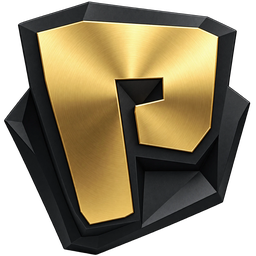
  </picture>
</p>

<h1 align="center">NeoPedal</h1>

<p align="center">
  <b>Telemetry overlays and analysis tools for Le Mans Ultimate and rFactor 2</b><br>
  93 overlays with a modern design, a telemetry viewer, race strategy, driver stats and a broadcast director.<br>
  Free and open source, in English and French.
</p>

<p align="center">
  <a href="https://github.com/Keenny38/ModernTinyPedals/releases/latest"></a>
  <a href="https://github.com/Keenny38/ModernTinyPedals/releases"></a>
  <a href="LICENSE.txt"></a>
  
</p>

<p align="center">
  <a href="https://github.com/Keenny38/ModernTinyPedals/releases/latest"><b>Download</b></a> ·
  <a href="#quick-start">Quick start</a> ·
  <a href="#features">Features</a> ·
  <a href="https://github.com/Keenny38/ModernTinyPedals/wiki">Wiki</a> ·
  <a href="CHANGELOG.md">Changelog</a> ·
  <a href="docs/ROADMAP.md">Roadmap</a>
</p>

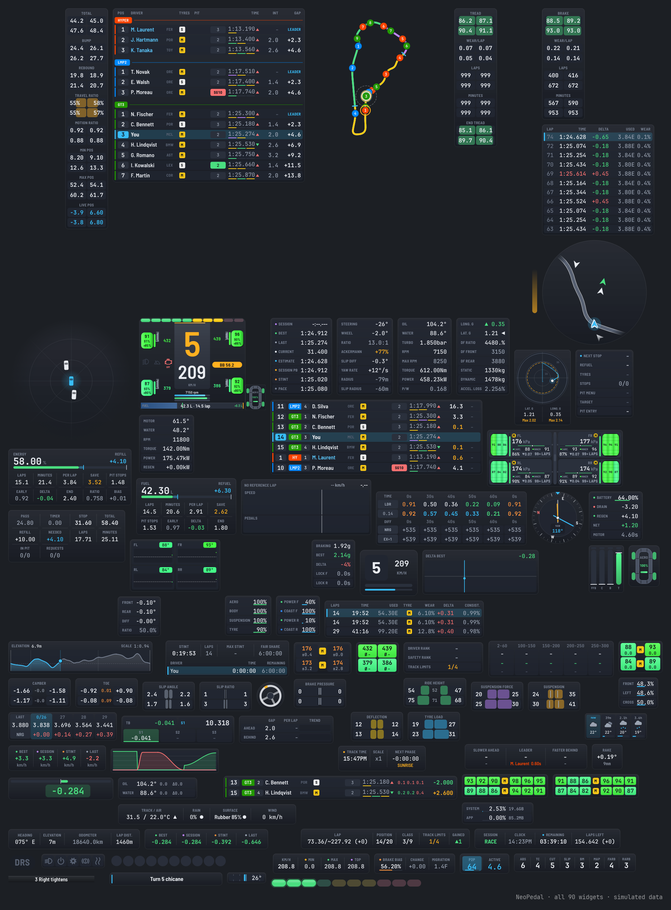

NeoPedal is a telemetry overlay and analysis app: a modern design, a clear interface, many tools and a lot of work on reliability.

> [!NOTE]
> **New in 0.28.0**: **hotkeys on your wheel, button box, joystick or gamepad** (and mouse buttons), **signed updates**, a **command palette** (`Ctrl+K`), a **notification center** and a keyboard shortcuts sheet (`Ctrl+/`), dialogs inside the app with undo. **Race calculator Team tab**: line-up and driver of each stint, with the real LMU team names. A **class square** and a `Driver Badge` column in Relative, Standings and Rivals, each Fuel and Virtual Energy value on its own, settings applied without reloading the app, and hundreds of fixes from audits of the overlays, pages, performance and security. Remote control commands that close, restart or switch preset now need the access token. All the details, with screenshots, in the [changelog](CHANGELOG.md).

---

## Quick start

1. **Download** `NeoPedal-<version>-windows-setup.exe` from the [Releases](https://github.com/Keenny38/ModernTinyPedals/releases/latest) page and run it. No administrator rights needed: the app installs in your profile (`%LOCALAPPDATA%\Programs\NeoPedal`).
2. **Prepare the game**: `Borderless` or `Windowed` display mode (exclusive fullscreen hides the overlay), then the setting of your game below.
3. **On first launch**, the setup wizard asks for the language, the game (a running game is picked for you), metric or imperial units, the themes (previewed) and the overlays to start with (shown as pictures).
4. **Start a session**: the overlay shows up as soon as the car is on track and hides otherwise.

Then:

- **Move the overlays**: unlock the overlay (`Unlock Overlay` on the Home page, or notification area icon menu > `Lock Overlay`): move the mouse over an overlay and drag it: it snaps to the screen and to each other overlay, arrow keys move the selected one and `Ctrl+Z` undoes. The edit mode toolbar (snapping, grid, guides, undo) is in the right-click menu of an overlay (`Edit Mode`), or shown at each unlock with `Settings > Overlay Style > Overlay Editing > enable_edit_mode_on_unlock`. Or move them in the screen view of the `Overlays` page (snapping, arrow keys, a screenshot of the game as background).
- **Configure an overlay**: gear of its card in the `Overlays` tab (or right-click the overlay) opens the Overlay Options page, where every overlay is one click away. `Ctrl+F` searches for an option by name.
- **Updates**: the app tells you about a new version (checked at startup, then every 12 hours while it runs), shows its release notes in your language (with the versions you skipped, searchable, screenshots, option names that open the option) and can download and install it (`Download And Install`). After an update, what's new opens once at the first start.

Each release has the Windows installer (`-windows-setup.exe`, also zipped as `-setup.zip`) and the source code (`-source.zip`). The portable ZIP is no longer published: to turn an older portable copy into an installed one, install the setup into its folder, your presets and data are kept. See [Installation](https://github.com/Keenny38/ModernTinyPedals/wiki/Installation) for details and for verifying your download.

### Game setup

| Game | Windows | Linux |
|---|---|---|
| **Le Mans Ultimate** | Nothing to install. Enable `Settings > Gameplay > Enable Plugins`. | Needs a third-party plugin, see [Game setup](https://github.com/Keenny38/ModernTinyPedals/wiki/Game-Setup). |
| **rFactor 2** | [rF2SharedMemoryMapPlugin](https://github.com/TheIronWolfModding/rF2SharedMemoryMapPlugin#download) plugin. | [Wine version of the plugin](https://github.com/schlegp/rF2SharedMemoryMapPlugin_Wine/blob/master/build). |

For rFactor 2: copy `rFactor2SharedMemoryMapPlugin64.dll` into `rFactor 2\Bin64\Plugins` (create the folder if it is missing), enable it in `Settings > Gameplay > Plugins`, then restart the game. If the plugin does not show up, install the `Visual C++ 2013` runtime found in the game's `Support\Runtimes` folder.

With Le Mans Ultimate, the app also reads the game's local REST API (nothing to set up): chat, contacts, replays, team stints, fuel consumption estimate, official track layouts, and the real car brand logos, circuit logos, car pictures and circuit pictures of the game menus.

---

## Features

### Overlays with a modern design

93 configurable overlays: tyres, brakes, fuel and energy, delta, speed delta, timing, standings, radar, map, weather, engine, suspension, chat…

- **One rounded panel per overlay**, Barlow font, short translated labels above the values.
- **Values colored by meaning**, the same in every overlay, app page and stream source: purple best, green gain or personal best, red loss or penalty, orange pit, yellow slower sector, gray garage.
- **Standings, Relative and Rivals like a timing tower**: running lap time with sector bars, then the completed lap with its colors, pit status and pit stops in one column, the **real penalties** of the game (`DT`, `SG10`), column labels, gaps in class timed like a timing screen, tyre compound badges, `Energy per Lap` and `Track Limits` columns, a header per class and classes in the order you choose. Gap trend (gaining or losing per lap), `Track Limits`, `Energy per Lap`, lap time delta and Driver Rank columns in Relative, Standings and Rivals alike.
- **Driver Rank** (Le Mans Ultimate): your Driver Rank and Safety Rank as the game menu shows them, with the progress to the next tier and your track limits points.
- **Track map** with each sector colored like the game live timing (purple class best, green personal best, yellow slower) and a ring on cars less than 1 s ahead or behind. Official corner numbers (or names) on the track map and the elevation profile (`show_corner_numbers`).
- **Speed Delta**: your speed difference to your best, session best, stint best and last lap at the same place of the lap.
- **Fuel and energy** with gauge and marks, **tyres and brakes** as tiles in the heatmap colors with the compound as a badge, **LEDs** as glowing dots, **Trailing** with pedal bars beside the plots.
- **Real logos & pictures of the game** (Le Mans Ultimate): car brand logos in Relative, Standings and Rivals, circuit and brand logos, car and circuit pictures on the Home, Results & Replays, Driver Stats, Spectate, Race Calculator and Telemetry pages and in the stream overlay of race results. They are taken from the game running on your computer and kept in the `gameimage` folder (your own logos in `brandlogo` come first).
- **Graphic overlays drawn for the design**: round radar fading at its edge, track map with numbered car dots and a checkered start line, navigation view, friction circle with a fading trace, compass heading, steering wheel, instrument and weather icons drawn as shapes in the theme colors.
- **Flags as colored chips** (caption above value, only while active): penalty to serve, last lap, heavy damage, gap of the car lapping you, pit limiter against the pit speed limit, alerts flashing when raised, **chat** feed with sender colors, **elevation** profile with the driven part highlighted, **race notifications** with icons and a time bar, **steering meter** growing from center, **RPM LEDs** showing their color zones before they light up.
- **Simplified options**: the configuration only shows what the design uses. The classic look is still available, for every overlay (Legacy themes) or just one, and each design reads the options of the other (trace fade, extra digits, wind, invalid lap...).
- **Four themes**: Modern Dark, Modern Light, Legacy Dark and Legacy Light (classic look), each with a colorblind safe variant. Light themes keep flags and warnings in their colors and darken the others so they stay readable. **Darker panels** for the modern dark themes: background opacity and a solid black background, and one opacity for every overlay at once, on screen, stream and VR (`Overlay Style`).
- **Visibility by session** (practice, qualifying, race) and pit lane, with fade.
- **Race aids**: delta graph over the lap, gap trend ahead and behind, pit lane helper (speed limit, pit limiter, distance to the box), stint timer and driving time per driver, spotter on the screen edges, race notifications, tyre temperature trend, and **telemetry compare**: your live speed, pedals, steering and gear over the reference lap of the telemetry viewer, with the next braking point ahead of the car, delta and speed difference.
- **Corner Coach**: the next corner (official number or name) and its distance, your braking point against the reference lap (on point, early or late, in meters) and the apex speed of the last corner against the reference.
- **Wind Direction**: compass turning with your car and an arrow showing where the wind blows, colored by its strength. **Wheel Dimension**: front and rear tyre radius measured while driving.

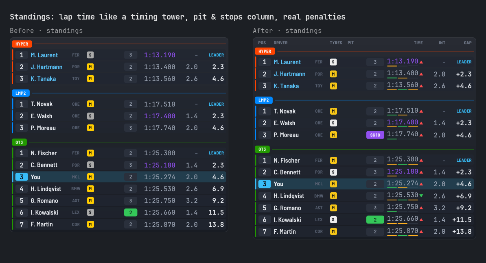

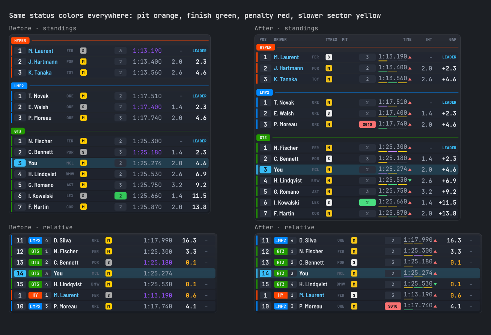

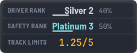

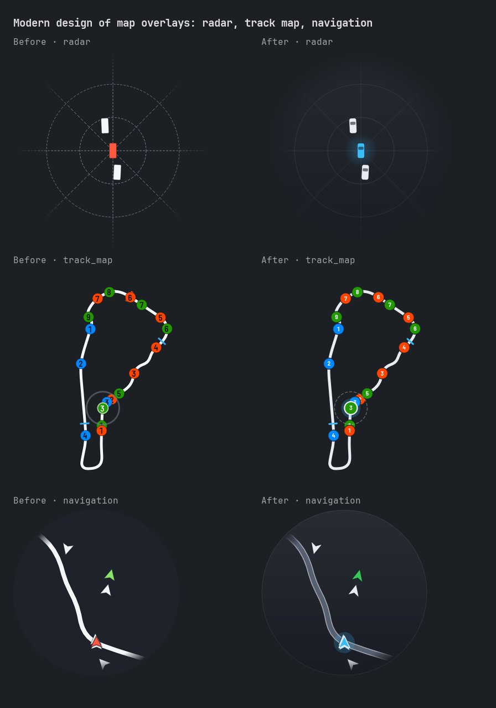

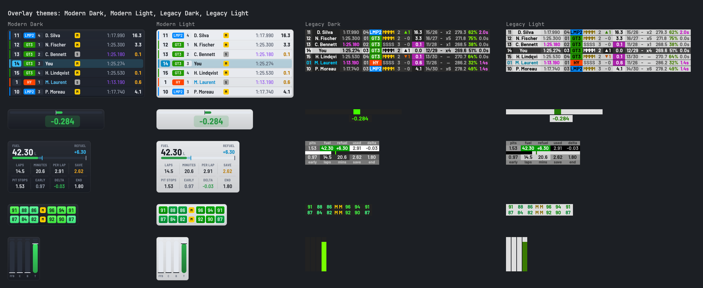

**Dashboard HUD** (formerly Black box): tyres, brakes, suspension, damage, fuel and energy gauges, incident log (contacts with the other driver's name, penalties, track limits), ABS, TC, brake bias and engine map chips, a pop-up showing each setting you change in the car (`TC 4/9` ▲, green up, red down), track limits points, gaps, lift & coast and wipers, with no overlap even when the wheels turn. Save your own display profiles. In the modern design it keeps its layout and all its options, drawn in the Barlow font and the theme colors. On the Overlay Options page, click a part of its picture to jump to its options.

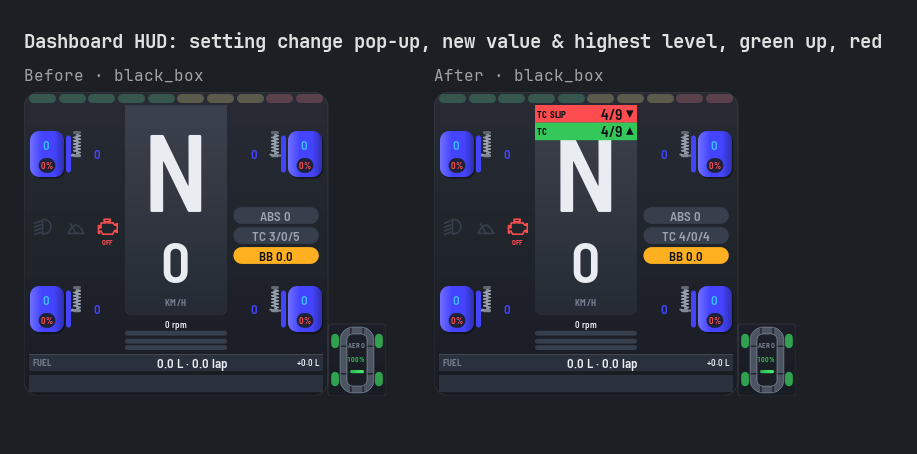

### Telemetry viewer

Every lap is recorded and analyzed in a GPU-drawn viewer: smooth zoom, laps grouped by session, several laps overlaid. Heavy work (charts, map, delta, MoTeC export) runs in the background, so long laps do not freeze the page.

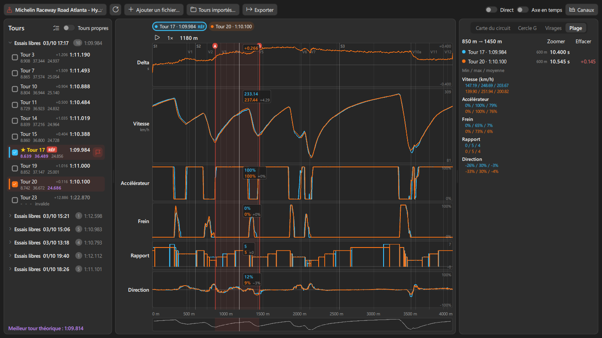

- **Charts**: gap to reference at the cursor, A/B markers and range statistics, computed channels (wheel slip, steering speed, fuel used, TC/ABS cut, aero balance, rake, damper velocity), 4-wheel panels, min/max band, smoothing, animated lap playback, Live mode, track notes shared with the Track Notes overlay.
- **Track map**: official layout and track edges from the game (LMU), braking, apex, exit and outside points of each lap, off-tracks and track limits, 9 colorings (by lap, gain/loss, speed, pedals, racing line, gear, altitude, gap per corner, mini-sectors), ruler, mini-map.
- **Corners**: time, entry, minimum and exit speeds, gear, brake pressure, ideal lap, and **where the time is lost** with the reason in plain words ("Brakes 6 m earlier").
- **Session**: long run pace and lap time trend, fuel and wear of each lap, sector times and corner values (minimum speed, braking point, corner time) over the session. **XY**: scatter plot or histogram of any channels.
- **Share a lap** with another driver as one file, optional 100 Hz recording.
- **Simple View** (switch with `Advanced View`, the charts): the shown channels at the cursor drawn like the overlays: pedal gauges and a turning steering wheel for each lap, then engine, tyres (4-wheel tiles colored by temperature), brakes, chassis (G circle, suspension), electronics (TC and ABS lights), track and math channels, other laps as marks of their color. The steering wheel turns by its real angle (recorded with each lap). One `Show` menu picks the channels of both views, and one playback bar plays the lap in both.
- **Tools**: search, trash with undo (20 levels) and `Recently Deleted Laps` to restore older ones, lap used as delta best, open the replay at the cursor, **MoTeC `.ld`**, CSV and image export, MoTeC log import to compare with another driver's lap.
- **On track**: the Telemetry Compare overlay draws your live speed and inputs over the reference lap chosen in the viewer.
- **In-depth analysis**: values fitted to the visible part, math channels from a formula, laps aligned on braking, consistency per mini-sector, teammate laps, best lap in similar conditions, setup differences, corner report as HTML or PDF.

| Official layout, track edges and mini-sectors | Where the time is lost |
|---|---|
| 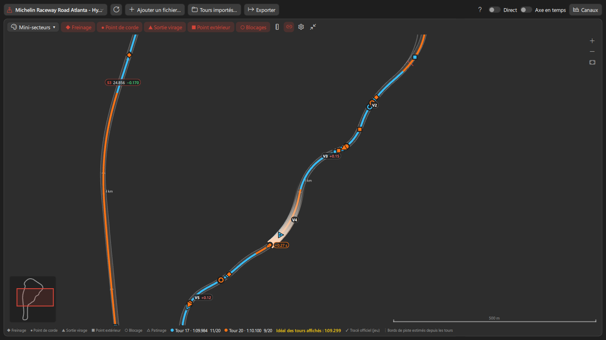 | 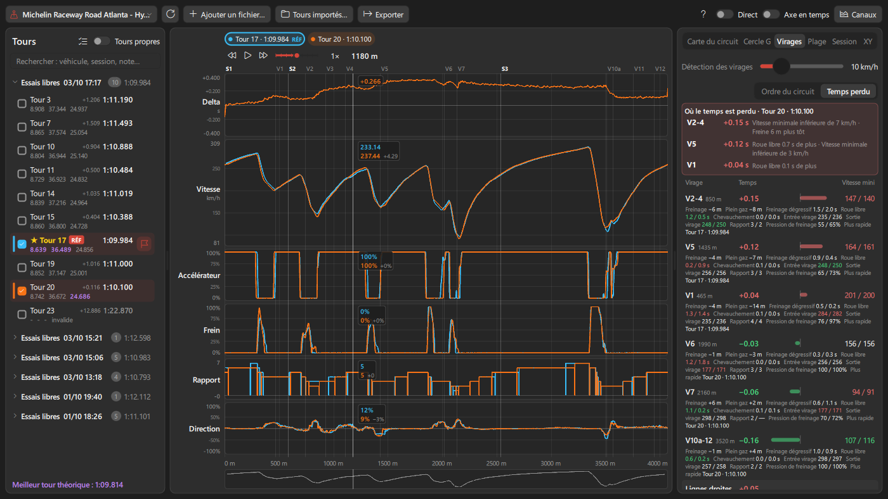 |
| **Session: long run and trend** | **XY: speed / lateral G** |
| 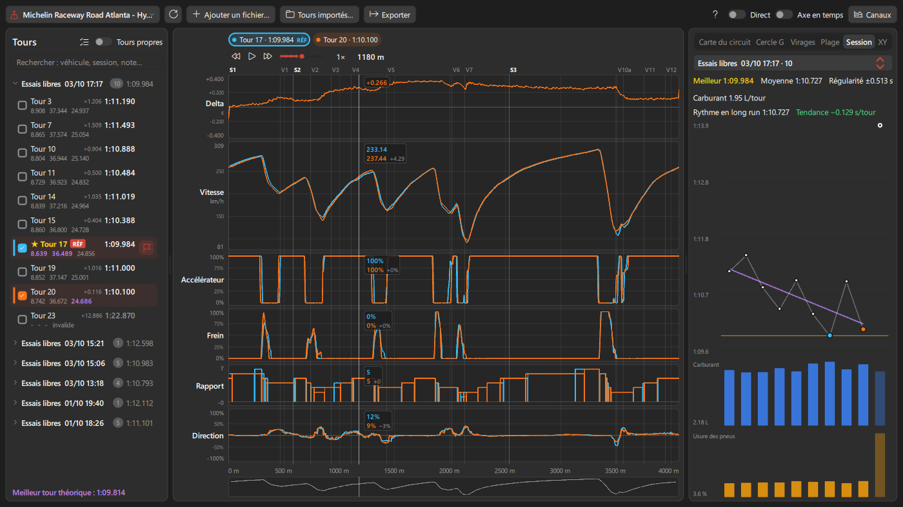 | 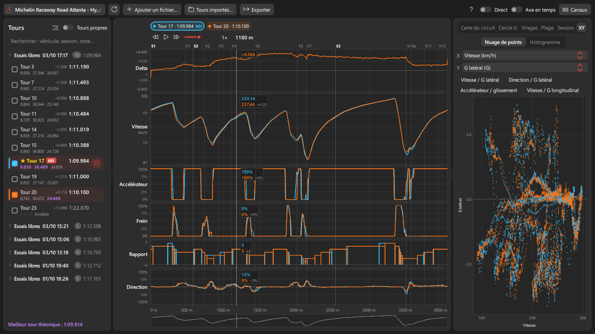 |

The **track map viewer** also shows each track by sectors with the real corner numbers, the curvature and slope at each point, the altitude profile and an animated run. Recorded maps are listed with a search, `.svg` maps can be dropped on the page, and a map that fails to load keeps the one shown.

### Race calculator

Fuel, energy and tyres on one page, to prepare a race and follow it live.

- **Modern page**: key figures and the strategy timeline (with the fuel in the tank) always in view, input sections that fold, tyres dragged from the stock onto the wheels of the tyre plan, values stepped with the arrow keys, and only what changes is redrawn.
- **Pit stop plan** lap by lap: full tank or just what is needed, tyres, driver, stop duration, pit window, time of each stop. Stints limited by tyre life if you want.
- **Safety car and rain scenarios**, compared with the normal plan. **Strategy comparison** with one stop less (fuel saving) or more, and the cost of saving. **Safety car risk**: chance of a safety car over the race, stops it saves, and for each stint whether to stop under it.
- **Tyre pace**: time lost by used tyres (tyres changed when it pays), lap time difference of each compound, and the whole race compared on each compound.
- **Several drivers** with minimum and maximum driving time (minimums that cannot fit in the race are shown, not planned in one-lap stints), balanced stints, mandatory stops, maximum stint, fuel effect, lap time per °C of the forecast temperature.
- **Live race**: the plan for the rest of the race is recalculated every lap from the car, with the real driver in the car (matched by name to the team line-up) and the driving time of each stint, penalties to serve and pending repair. **Where you rejoin** if you stop at the end of this lap (class place, gaps), and **Pit Menu** sets the refill of the next stop in the LMU pit menu.
- **Live tab**: every value the game gives next to the calculator, filled in one by one or all at once: race length, formation, start time, drivers, lap time, consumption, tank, compound, starting amounts on the grid, pit lane time, refuel and energy rates, tyre and driver change times (LMU pit stop times), tyre allocation, rain forecast. Race under way (flags, penalties, pending repair, class position) and the tyres the pit menu offers, used tyres added to the tyre stock with their tread.
- **Team tab**: plan an endurance race ahead: line-up typed before the race (names replaced by the real LMU team names once in the game) and the driver of each stint (`Auto` or a chosen driver, rotation kept), names in the plan, timeline and exports; stints of each driver of the car read from the game (LMU), teammates included.
- **Sharing**: export for Discord, CSV or image (`Show in Folder` once exported), plan saved per car and track.
- **Recent files** for consumption histories, race plans and tyre plans, and these files dropped on the page or the window.
- **On / off switch**: turned off, the page asks the game nothing and frees its memory when hidden.
- The **Race plan** overlay shows the next stop of the plan on track, the distance to the pit entry and the target consumption, planned with the lap time and consumption of the race so far even with the page closed.

<p align="center">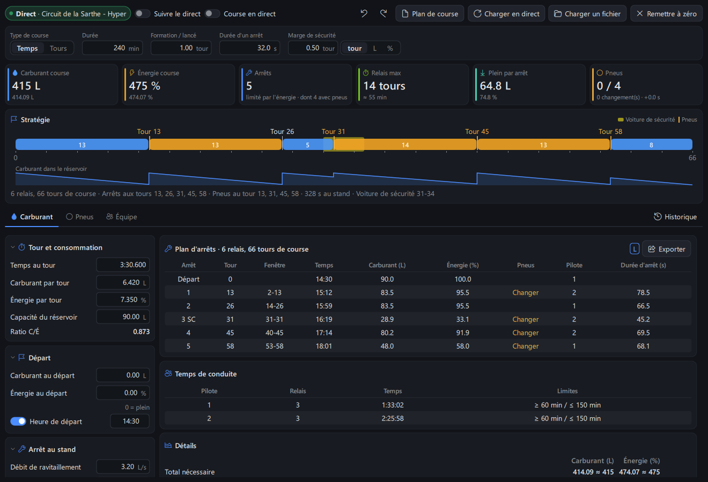</p>

### Driver stats

Your numbers per track and per car, compared with the LMU community times (sheet by [ohne_speed](https://www.youtube.com/@ohne_speed)), with a level from Alien to Offline.

- **Level scale** of each vehicle: where your personal best, qualifying and race bests stand, and the time to find for the **next level**.
- **Progress** of your session best, session after session, next to the list of **sessions** with race results, class position, incidents and **game version** (personal best line too); click a session to open its race results.
- **Driver card**: your game profile and Steam picture, **Driver Rank & Safety Rank** with their progress and the change since your previous rank, your badge, races from the game results files (wins, podiums, average finish, clean races), and lap times found in the results that your stats miss, completed in one click.
- **All tracks**, the page that opens (again after 2 minutes away): your career on one page, with the level of each best lap, a **daily activity calendar** and your **recent sessions**.
- **Theoretical** best lap and potential, starts, wins, podiums, retirements, consumption per 100 km.
- **Telemetry** button to open the vehicle's recorded laps in the viewer.
- **Pace and degradation per tyre compound**, consistency index, CSV / JSON export and **comparison with a friend**.
- **Road conditions of each session** (dry or wet road, track temperature, tyre compound of the best lap), start position and online or offline, recorded by the Stats module: filter the progression and sessions by **road**, **server** or **since a game version**, with a **wet PB** and a **PB of the latest game version** in the table.
- **Lap time goal** per car (suggested from the next community level): progress bar, goal line on the progression chart, a message once it is beaten.
- **Places gained** in races, **clean race** rate and streak, **rivals** met in several online races (ahead / behind, best lap gap), **rank history** of your Driver & Safety Ranks.
- Table **search**, **class filter** and **grouping by class**, combos not driven for a month marked, activity of **any year** with driving time **by track and by class**.
- **Official races to come** (option, RaceControl) with your best laps on their track, and your personal best shared as a **picture card** or a **code** to paste in a chat (a friend's code is compared and can become your goal).

| Track: goal, filters, wet PB, sessions | All tracks: driving time by track & class, official races |
|---|---|
| 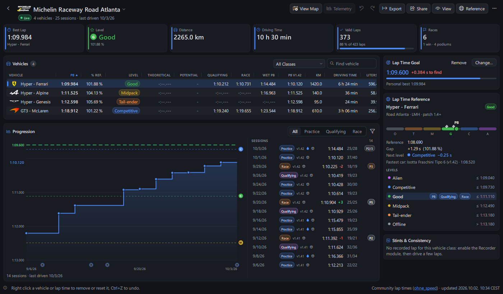 | 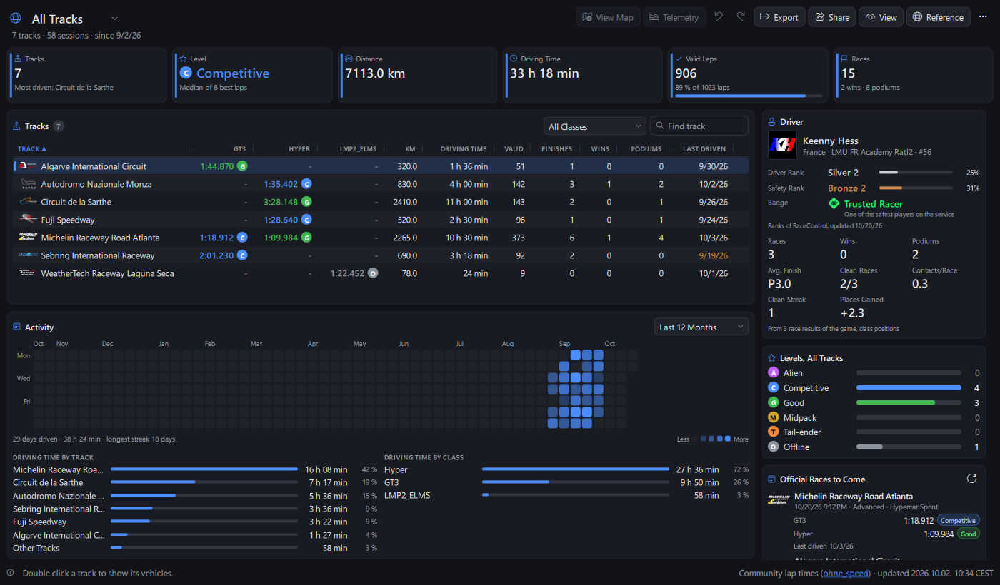 |

### Results & Replays

Every session you played, online or single player, read from the results files of Le Mans Ultimate and rFactor 2 (no setup, the game does not need to run), and the replays saved by Le Mans Ultimate, on one page.

- **Sessions** by day with your result, search and filter (races, qualifying, practice, `Clear Filters` when nothing matches); a session that ends while the page is open shows up at once, a results file that can't be read is flagged.
- **Your key figures**: position and class position, places gained from the grid, best lap and its rank, laps and pit stops, contacts, track limits and penalties.
- **Classification** by class, with race time and gaps (also for a race left before its end), best laps, pit stops and contacts.
- **Positions lap by lap**, the **laps of any car** (sectors, top speed, tyres, energy used and tread left for your car) and the **events** of the session: contacts, penalties, track limits and chat.
- **Replays linked to their results** (LMU): a flag on each replay that has a results file, `Watch Replay` on the session, and a **play button on every event and lap** that opens the replay a few seconds before that moment, camera on the car concerned.
- **Replays list**: replays by day with search and filters, add / export / rename / protect / delete (moved to the recycle bin in the background, with progress and stop), playback, camera and HUD controls, drivers standings, track map with the cars, incident timeline.

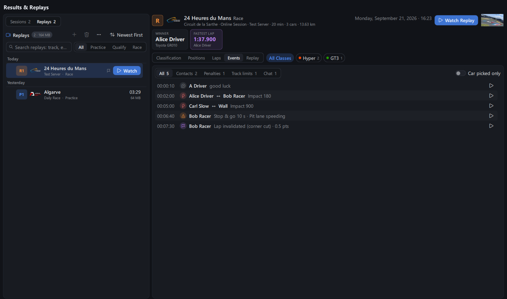

| Classification of a multiclass race | Positions lap by lap |
|---|---|
| 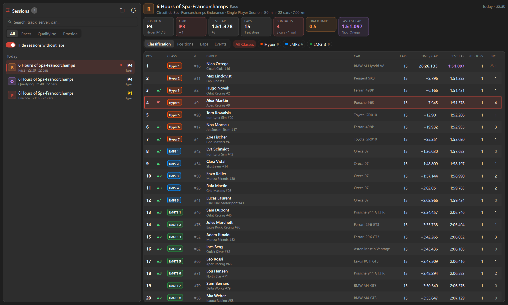 | 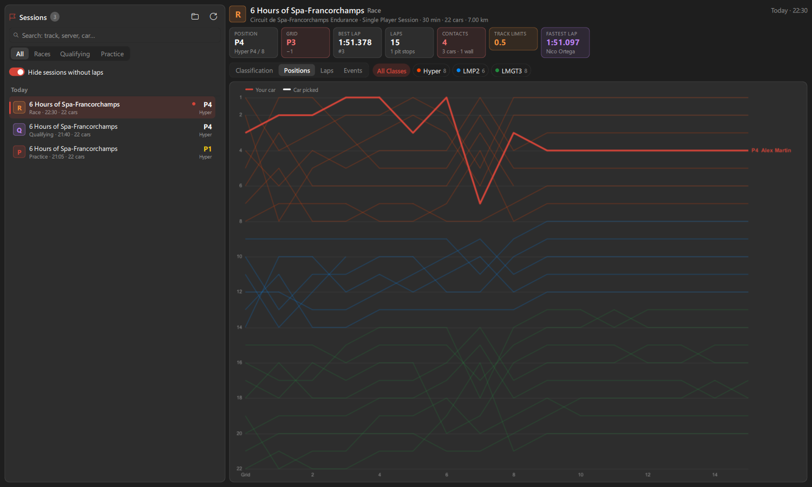 |

### Le Mans Ultimate: game data

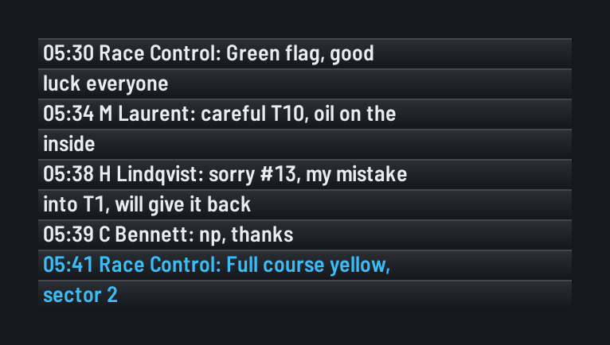

- In-game **chat** as an overlay, handy in VR.
- **Game replays** linked to the race results, see [Results & Replays](#results--replays).
- **Driver Rank & Safety Rank** of the game menu, kept with their history per Steam account (last ones shown when the game forgets them), or read live from RaceControl after each session (`enable_online_driver_ranks`, on by default), with every driver's ranks on online servers (Relative & Standings column, strength of field of each class, field average, Broadcast Director cards).
- **Broadcast Director** to cast a race, see [below](#broadcast-director-le-mans-ultimate).
- **Contacts** written to the Dashboard HUD incident log, with the other driver's name.
- **Fuel consumption estimated by the game** until a lap is recorded on the track.
- **Setup name** kept with each recorded lap.
- **Allowed tyres**, **team stints**, **pit stop times**, tyres of the pit menu and session settings used by the race calculator.
- **In the overlays**: official delta, invalidated lap, puncture, ideal tyre temperature, sector yellow flags and full course yellow, wind, ride height, pit limiter, engine overheating.

<br clear="right">

### Broadcast Director (Le Mans Ultimate)

Cast a race live (driving or spectating an online race) or in a replay, from the `Broadcast` entry of the navigation bar.

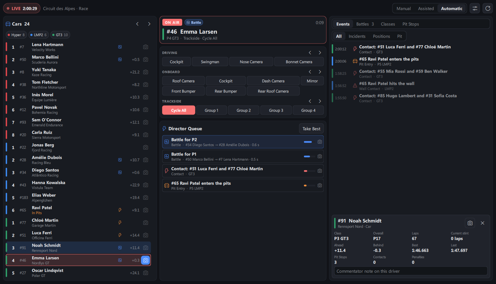

- **Cars** by place with intervals measured on track, sectors colored as on TV, places gained, tyres, pit lane times, lap history of each car, and a **timing table** with race, qualifying and pits views.
- **Camera desk**: the car on air and every game camera in one click, replay controls in a replay.
- **Director**: battles, overtakes, lead changes, contacts (with their severity), stopped and slow cars, yellow flags, pit stops, fastest laps and penalties found for every car. In `Assisted` mode they are listed by interest, in `Automatic` mode the director cuts to them with a suited camera. `Lock` keeps the car on air.
- **Commentator screen**: events, battles with trend, class leaders, pit stops and stints, car sheet with driver history and your notes. Unseen incidents, instant replay in a live session, CSV export and an optional events log.
- **Broadcast graphics** as one browser source (1920 x 1080): standings tower, driver card, battle card and battle train, banners, pit lane radar, replay graphics, onboard, qualifying lap, track map, session clock and weather, and on demand starting grid, event card, classification and championship standings (CSV). Placed with a **layout editor** in your browser, with layout presets, sources with some graphics only, league logo and sponsors, message and countdown.
- **On / off switch** at the top of the page (and `director_toggle` hotkey): turned off, the game is asked nothing; a dot on the `Broadcast` entry shows its state. The standings tower slides page after page with up to 70 cars, and the `Game HUD` menu hides the game UI for clean pictures.
- Overlays and stream sources can follow the car on air; hotkeys for Stream Deck and the remote control; direct from another computer.

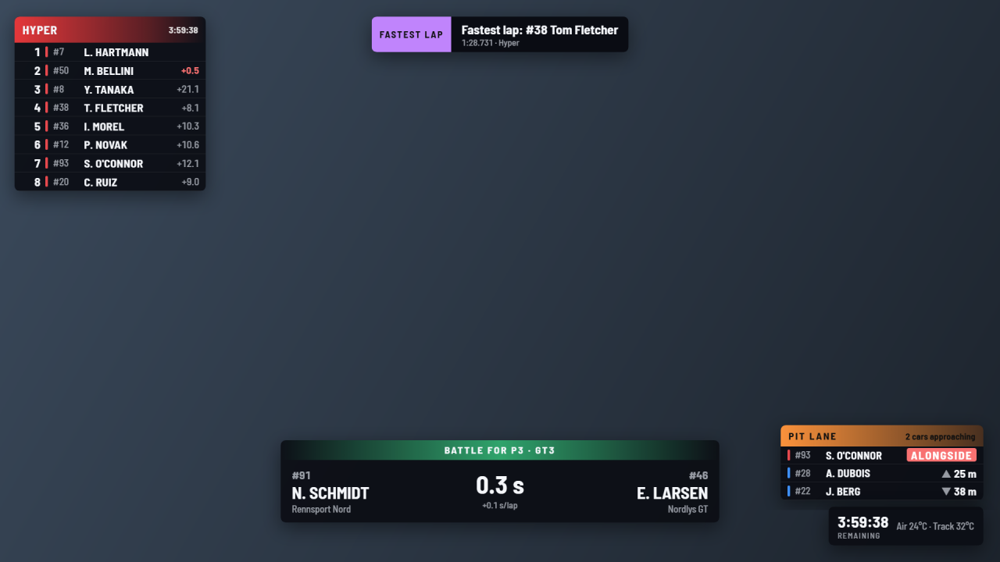

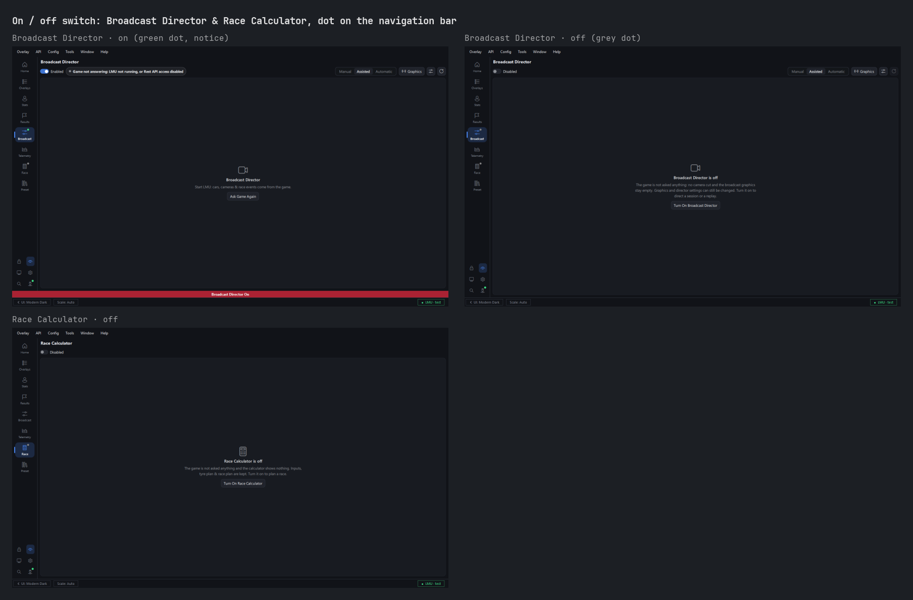

### Interface

- Qt 6 interface in **English or French** (switch without restarting), translated option names and tooltips, **release notes in the app language**.
- **Home page** (Qt Quick, 1 to 3 columns): **checks** of what keeps overlays from showing right (game open without data: plugins off, no overlay enabled, active state override, spectate mode, lap recording off, update available) with a button to fix each, else `Ready`; game and current session status (click: API options), overlay lock, preset (switch to another one from the card), overlays & modules enabled, last session (click: its track & car in Driver Stats), **session debrief** (best lap against your personal best, pace and consistency, theoretical best, fuel per lap, the three corners where you lose most time and why: **click a corner to open the telemetry on it**, charts zoomed; lap time goal with a progress bar), **your driver card** (Driver Rank & Safety Rank with their progress, change and **rank over time**, badge, team, race record of the results files, other Steam accounts of this computer below), customizable quick access (tools, pages, actions) and **release notes of the installed version**. The page reads the game and files only while it is shown.

<p align="center">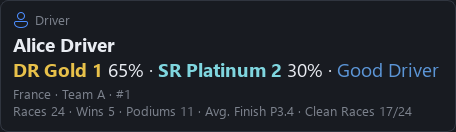</p>

- **Overlays page**: every overlay as a card with a preview drawn with your settings on a simulated race, played while hovered (or a compact list with what each overlay shows), a screen view to see and move running overlays at their place on your screens (overlaps outlined), favorites and recently edited overlays, sort, search ignoring accents, category chips with counts, badges for overlays shown only in some sessions or only on stream, the loaded preset one click away, enable / disable the filtered overlays, start errors flagged.
- **Modules page**: what each data module computes, its state, the enabled overlays and modules using its data (a module turned off that they need is flagged), reset of its saved data.
- **Everything opens inside the app window**: tools, editors and settings are pages, with back navigation (`Alt+←` or the mouse back button). A page you leave closes by itself (unless it has unsaved changes), so pages never pile up. Navigation bar tools stay as you left them and come back on next start, even after a crash.
- **Window size handled for you**: comfortable size centered on screen at first launch, size, position and maximized state remembered (even after a crash), wide pages grow the window only while open and keep it on screen, window brought back on screen when a monitor is unplugged, never shrunk below the size where pages show correctly (more for the telemetry viewer and driver stats), `Window` > `Reset Window Size and Position`.
- **Overlay Options page**: the options of every overlay in one page, overlays listed by category. Options in sections (general, position and layout, font, then one per item shown with its on/off switch, display order as a list), options of an item that is off dimmed, only the options of the design in use. Search this overlay or every overlay, `Changed only`, `Apply to All Overlays` for a shared option (font, opacity...), live preview with the unsaved values on a simulated race (sample race for Relative, Standings and Rivals, whose columns are one list to switch on or off and reorder), zoomed from 50 % to 300 % and drawn sharp at that size, in a panel you can widen, in a race situation (flags, pit, damage, rain) or with the other design, `Test on Screen` on the overlays shown, changes to several overlays kept pending with undo and applied at once (only the edited overlays restart).
- **Settings page** (navigation bar, `Ctrl+,`): every global option in one page by category (Application, Overlay Style, Notification, Compatibility, Remote Control, Web Dashboard, Stream Overlay, VR Overlay, User Path), with descriptions, a search through every category, changes kept pending with undo (also after `Apply`), discard and apply, notice previews, the web dashboard address and access code.
- **Find Option** (`Ctrl+F`): best matches first with the current value of each option, options changed from default marked (`Changed only` lists them all), on / off options switched right in the list, with undo / redo (`Ctrl+Z`, `Ctrl+Y`).
- **Presets page**: loaded preset and auto load on top, every preset with its last change, the overlays and modules it turns on, its car class (every session or practice / qualifying / race only) and track tags and hotkeys, details of the selected preset, name checked as you type for new, duplicate and rename.
- **Spectate page**: drivers of the session with place, class, car and best lap; click a driver to follow it, previous / next by place.
- **Setup wizard** (first launch, `Help` > `Setup Wizard`): six steps that switch language at once, running game detected, metric or imperial units, window and overlay themes previewed with real overlays, new or existing preset with overlays picked from pictures, summary before anything is applied.
- **Keyboard everywhere**: `Tab` reaches every button and switch with a focus outline, arrow keys change segmented choices, one search box on every page (`/` jumps to it, `Esc` clears then leaves), `Delete` deletes the selection.
- **Customizable navigation bar**, live overlay preview, undo / redo in editors.
- **Hotkeys** for overlays, presets, spectate, Dashboard HUD, Broadcast Director, and `show_main_window` to bring the main window in front of the game, even from the tray.
- **Overlay edit mode** on the game screen: toolbar (snapping, grid, guides, undo / redo, active overlays), every overlay outlined even when empty or auto hidden, magnetic snapping with alignment guides and position, arrow keys, right-click menu to move to another screen or set visibility and opacity, overlays outside every screen brought back.
- **Screen view** of the Overlays page to place overlays with alignment guides and snapping, arrow keys, a screenshot of the game as background; global scale, positions remembered per screen setup.
- **Share overlay settings**: one overlay or several you pick in a `.zip` file (`Share` menu of the `Overlays` and `Overlay Options` pages), imported with your positions kept and undo.
- **Preset packages**: a preset with its style presets (brakes, brands, classes, compounds, heatmaps, tracks) and notes in one `.zip` file to share, imported from the `Presets` page or dropped on the window. **Preset trash** with undo. `Settings` > `Import Settings…` copies the global settings of another copy of the app.
- **Unsaved changes** flagged on each page, `Ctrl+S` to save, values checked as you type.
- **Session recorder** (`Tools` > `Advanced`): record a session and replay it in every overlay, without the game, to test overlays or attach to a bug report.
- **Four window themes**: Modern Dark, Modern Light, Legacy Dark and Legacy Light (classic colors), chosen in `Settings` > `Application` > `Interface` (the native title bar follows).
- Gold and black or gold and white icon, following the Windows light or dark mode.

### Connections

- **Remote control** for Stream Deck, Companion or SimHub, and live telemetry stream over WebSocket.
- **Web dashboard** for phone or tablet, in your units and language, with access code and optional HTTPS.
- **Stream overlays** for OBS Studio, Streamlabs, XSplit or vMix: the overlays as browser sources (whole layout or one by one), transparent and exactly as on screen, also with the game in exclusive fullscreen and **while you spectate a race** or watch a replay. The `Layout` source is in 16:9 by default (centre of an ultrawide or triple screen), with a **layout editor** in your browser to place overlays on the stream. Each overlay on screen and stream, stream only or screen only, and the **classification of the last race** for your viewers, classes and pages cycling. A new access token asks first (browser sources need the new address), a layout reset can be undone.
- **VR**: experimental SteamVR overlay, and a mirror window for OpenXR games (to show in the headset with OpenKneeboard, OVR Toolkit, XSOverlay or Desktop+).

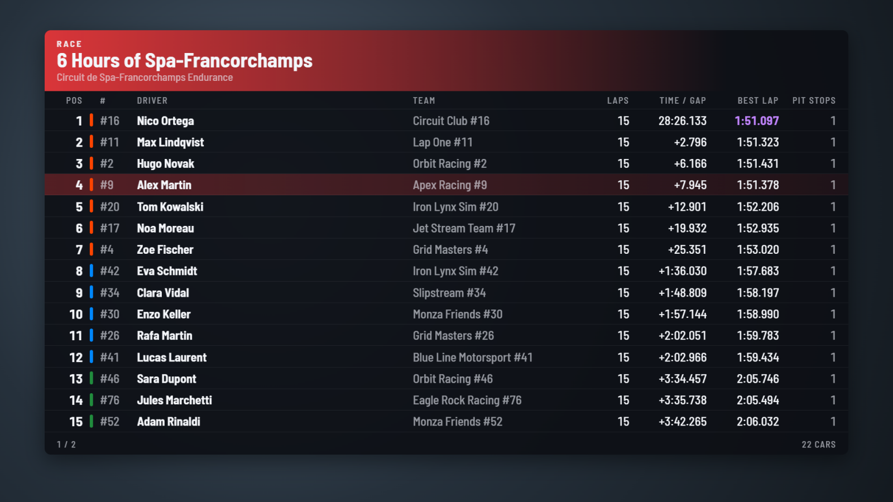

### Reliability

- Windows installer and **updates from the app**, with a check of the downloaded file (SHA-256 checked again on the file run, private download folder, and signature when the installer is signed).
- Automatic backups of presets and stats, atomic file writes (CSV and picture exports too), automatic restart of crashed threads, one running copy per settings folder (system lock, released even after a crash).
- Overlay plugins with a manager, one-click bug report, performance monitor with the game data status.
- **Light on memory, CPU and GPU**: overlays turned off and pages not opened are never loaded, tool pages hidden for 10 minutes are freed, the main window frees its pages and graphics while it waits in the tray, overlays repaint only when a value moves a pixel, background modules sleep until the game sends new data, VR and stream capture run only while used.
- **Safe mode** offered after a crash at launch (no plugins nor overlays).
- **More than 6,000 automated tests** (93% of the code covered), **real game sessions replayed** through every data module and overlay and checked against the game values, a ceiling on what the app loads at startup, type checking and lint in continuous integration, the executable is started in test mode before each release.

---

## Documentation

The [wiki](https://github.com/Keenny38/ModernTinyPedals/wiki) is the user and developer guide:

| Use | Develop |
|---|---|
| [Installation](https://github.com/Keenny38/ModernTinyPedals/wiki/Installation) · [Game setup](https://github.com/Keenny38/ModernTinyPedals/wiki/Game-Setup) · [Getting started](https://github.com/Keenny38/ModernTinyPedals/wiki/Getting-Started) | [Development](https://github.com/Keenny38/ModernTinyPedals/wiki/Development): run from source, checks, architecture, Windows build, release process |
| [Overlays](https://github.com/Keenny38/ModernTinyPedals/wiki/Overlays) · [Presets and settings](https://github.com/Keenny38/ModernTinyPedals/wiki/Presets-and-Settings) | [Contributing guide](CONTRIBUTING.md) |
| [Telemetry viewer](https://github.com/Keenny38/ModernTinyPedals/wiki/Telemetry-Viewer) · [Race calculator](https://github.com/Keenny38/ModernTinyPedals/wiki/Race-Calculator) · [Driver stats](https://github.com/Keenny38/ModernTinyPedals/wiki/Driver-Stats) · [Race results](https://github.com/Keenny38/ModernTinyPedals/wiki/Race-Results) · [Broadcast director](https://github.com/Keenny38/ModernTinyPedals/wiki/Broadcast-Director) | [Roadmap](docs/ROADMAP.md) |
| [Connections](https://github.com/Keenny38/ModernTinyPedals/wiki/Connections) · [Updates and security](https://github.com/Keenny38/ModernTinyPedals/wiki/Updates-and-Security) · [Troubleshooting](https://github.com/Keenny38/ModernTinyPedals/wiki/Troubleshooting) | [Security policy](SECURITY.md) |

Every option is described in the [settings reference](docs/customization.md) (also bundled with the app), and what changed in each version in the [changelog](CHANGELOG.md) ([en français](CHANGELOG.fr.md)). The wiki is generated from [docs/wiki](docs/wiki): edit it there.

## Run from source

Requires [Python](https://www.python.org/) 3.11 or newer.

```bash
git clone https://github.com/Keenny38/ModernTinyPedals.git
```

```bash
cd ModernTinyPedals
```

Create a virtual environment, activate it, then install the dependencies (PySide6, psutil, cryptography):

```bash
py -3.12 -m venv .venv
```

```bash
.venv\Scripts\activate
```

```bash
pip install -r requirements.txt
```

```bash
python run.py
```

The shared memory libraries (`pyLMUSharedMemory`, `pyRfactor2SharedMemory`) are included in the repository: no submodule to fetch. For exact tested versions, use `requirements-lock.txt`.

On Windows, `Download And Install` of an update found while running from source installs the Windows app (your installed copy is updated, then started); update the source folder itself with `git pull`.

On **Linux**, run the app from source the same way (no executable). Needed packages: `PySide6`, `psutil`, `cryptography` and `pyxdg`. `sudo ./install.sh` installs a launcher and the `NeoPedal` command in `/usr/local/`. Settings are in `$HOME/.config/NeoPedal/` and data in `$HOME/.local/share/NeoPedal/`. See [Installation](https://github.com/Keenny38/ModernTinyPedals/wiki/Installation#linux) for distribution packages and known issues (KDE, compositing).

> Settings and data folders are named `NeoPedal` (`%APPDATA%\NeoPedal`, `~/.config/NeoPedal/`, `~/.local/share/NeoPedal/`). The executable is `neopedal.exe` (Linux: `NeoPedal` command, `/usr/local/share/NeoPedal`).

## Contributing

Report a problem or suggest an idea in the [issues](https://github.com/Keenny38/ModernTinyPedals/issues). The contribution rules (development setup, checks, project rules) are in [CONTRIBUTING.md](CONTRIBUTING.md), and what is left to do in the [roadmap](docs/ROADMAP.md). A security vulnerability is reported privately, not in an issue: see [SECURITY.md](SECURITY.md).

## License and credits

Copyright (C) 2022-2026 TinyPedal developers, see [NOTICE.md](NOTICE.md) and [docs/contributors.md](docs/contributors.md) for the list of developers and contributors.

Free software under the [GNU GPL v3](LICENSE.txt) or any later version, distributed WITHOUT ANY WARRANTY. The icon and the images of the `images` folder are under [CC BY-SA 4.0](https://creativecommons.org/licenses/by-sa/4.0/). The [Barlow](https://github.com/jpt/barlow) font is under the SIL Open Font License 1.1 (`fonts/OFL-Barlow.txt`). Third-party software licenses are in [docs/licenses](docs/licenses/THIRDPARTYNOTICES.txt).
